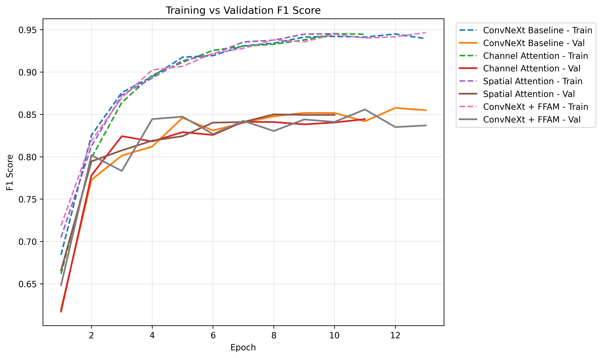
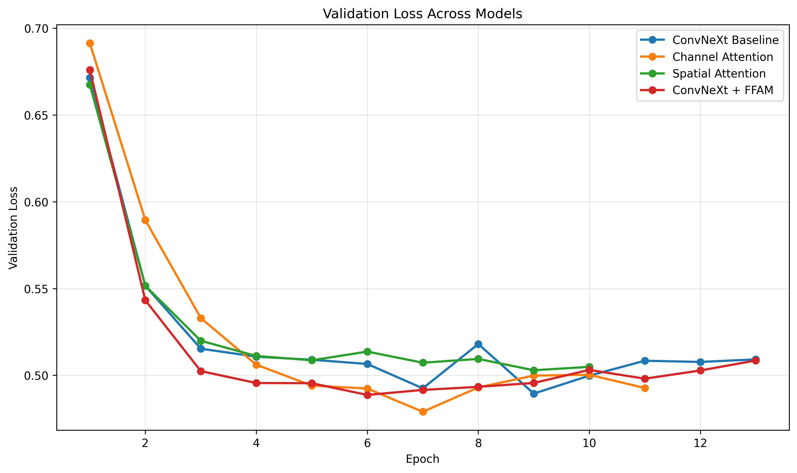
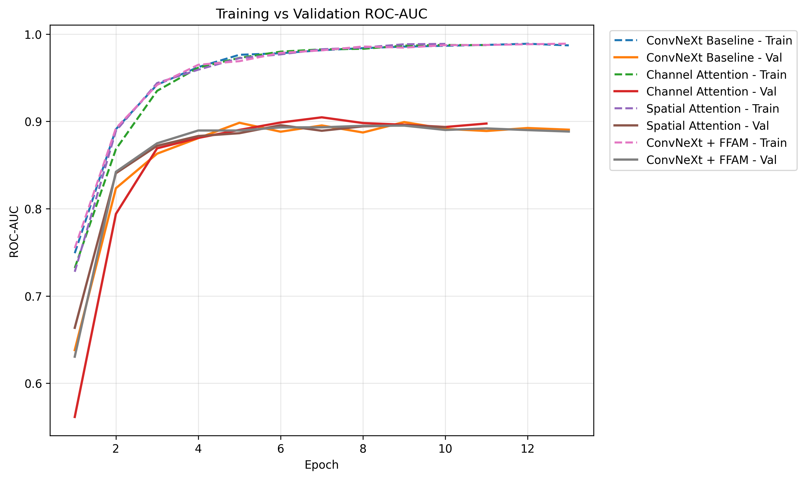
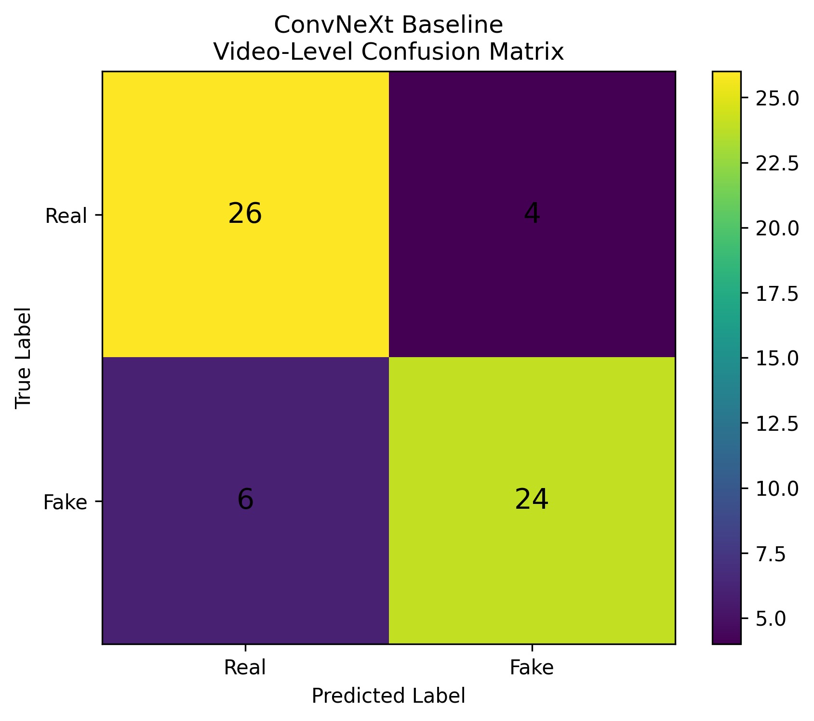
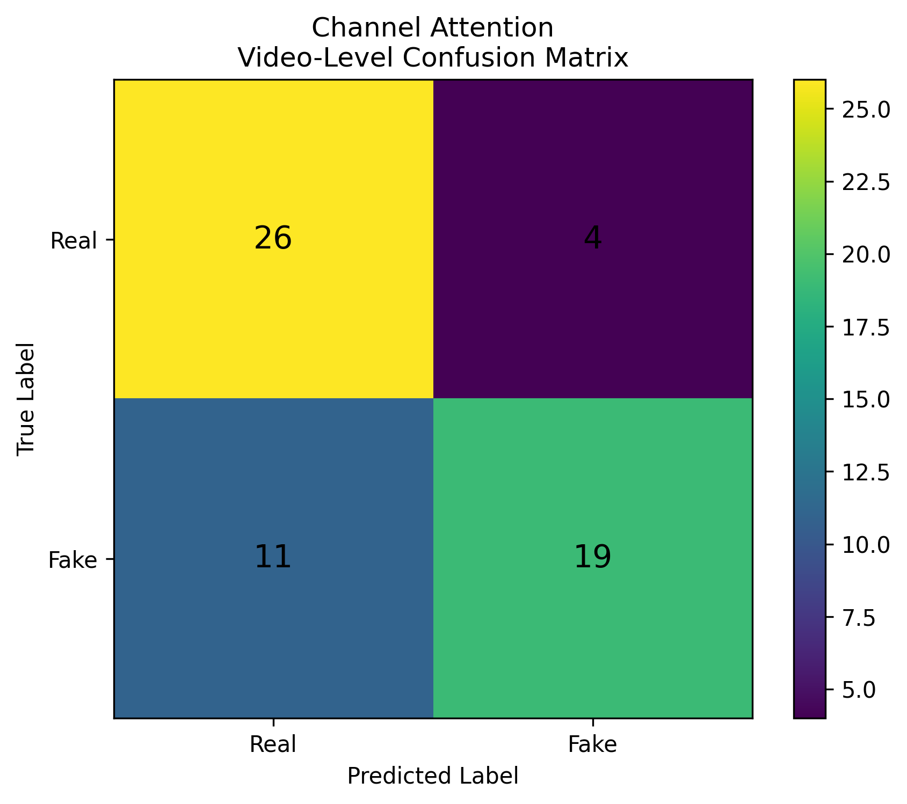
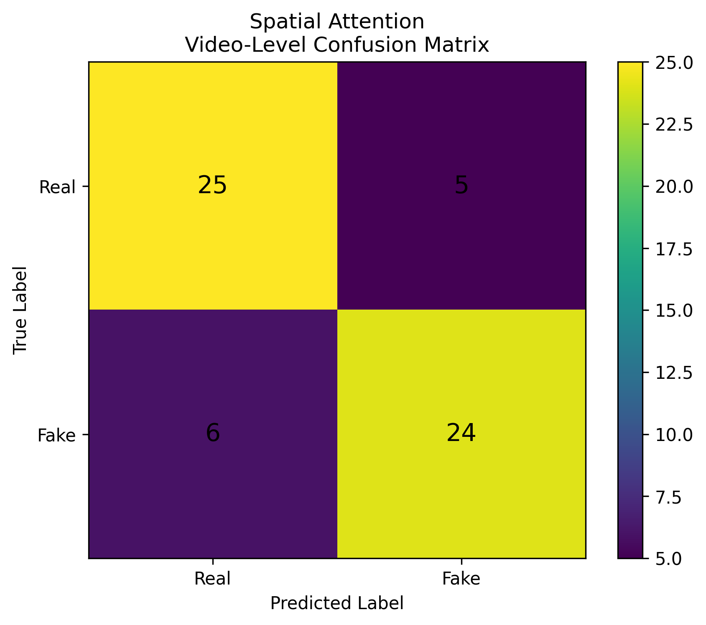
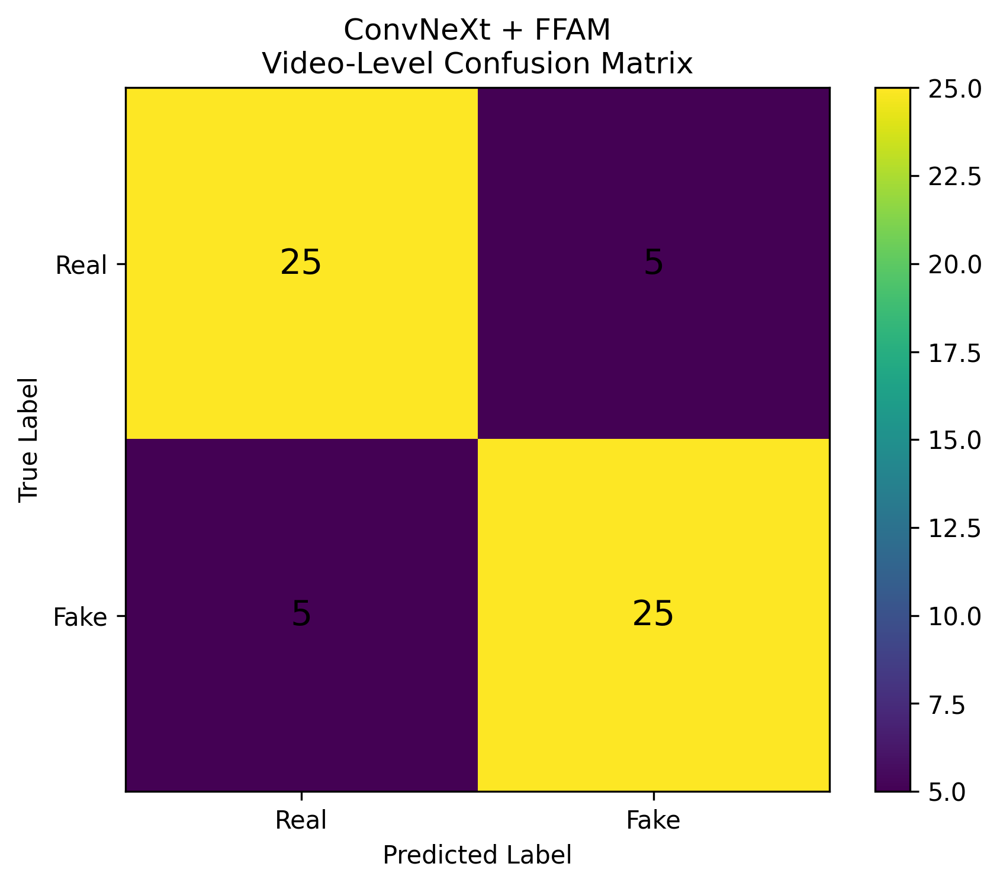

# Deepfake Detection with ConvNeXt-Tiny: A Controlled Attention Ablation Study

> **Research focus:** visual deepfake detection, controlled architectural ablation, video-level evaluation, and reproducible model comparison.

This project examines a focused question in visual media forensics: **when the backbone, data split, frame-sampling strategy, and evaluation protocol are held constant, do channel attention, spatial attention, or their combination improve deepfake detection?**

Using a 400-video subset of FaceForensics++, the study compares a pretrained ConvNeXt-Tiny baseline with three attention variants. Rather than reporting only a headline accuracy, it evaluates multiple complementary metrics, retains underperforming ablations, audits the dataset split, and reports bootstrap confidence intervals for video-level ranking metrics.

The goal is not to claim a universally reliable or state-of-the-art detector. The project is a controlled, inspectable experiment designed to test an architectural hypothesis and make its limitations visible.

---

## Table of contents

- [Research motivation](#research-motivation)
- [Literature-informed positioning](#literature-informed-positioning)
- [Research questions and hypothesis](#research-questions-and-hypothesis)
- [Experimental design](#experimental-design)
- [Dataset and split protocol](#dataset-and-split-protocol)
- [Model variants](#model-variants)
- [Training and evaluation](#training-and-evaluation)
- [Results](#results)
- [Interpretation](#interpretation)
- [Repository contents](#repository-contents)
- [Reproducing the experiment](#reproducing-the-experiment)
- [Limitations and threats to validity](#limitations-and-threats-to-validity)
- [Next research directions](#next-research-directions)
- [Responsible use](#responsible-use)
- [References](#references)

## Research motivation

Deepfake detection remains challenging because detector performance can depend on how manipulations were generated, the visual artifacts retained after compression, the subjects and scenes represented in training data, and the similarity between training and deployment distributions. A result on one dataset subset should therefore not automatically be interpreted as evidence of generalization to unseen identities, manipulation pipelines, or contemporary generative systems.

A second issue is **experimental attribution**. If several architectural and training changes are introduced simultaneously, an observed performance difference cannot be confidently attributed to any single design choice. This study narrows the comparison to one family of models and tests attention components under a shared protocol. Both improvements and regressions are retained as findings.

## Literature-informed positioning

The preliminary literature review that informed the project explored several lines of deepfake-detection research:

- **CNN-based detectors and established visual backbones**, including VGG- and Dense-CNN-style models and Xception-based deepfake detection.
- **Face-based preprocessing**, where face detection and cropping are used to focus the classifier on manipulated facial regions.
- **Vision foundation-model approaches**, including CLIP-style representations and work addressing newly generated or cross-type manipulations.
- **Domain adaptation and cross-dataset generalization**, motivated by the gap between the manipulation distribution represented in training data and the distribution encountered at test time.
- **Explainable and multimodal detection**, which broadens the problem beyond a single visual classifier to explanations or evidence from multiple modalities.

Across these themes, the review highlighted recurring research concerns: performance degradation on unseen manipulation types, sensitivity to image quality and compression, narrow dataset construction, and the difficulty of inferring real-world robustness from one benchmark score.

**The present experiment does not implement or directly compare all of those reviewed methods.** In particular, it is a visual-only ConvNeXt-Tiny attention ablation; it does not perform audio-video fusion, CLIP-based detection, domain adaptation, or a dedicated explainability study. The review is used here to motivate the research question and future experiments, not to imply that those methods were reproduced. Full bibliographic details should be verified before the preliminary review is used as a formal reference list in a paper.

## Research questions and hypothesis

The experiment addresses the following questions:

1. How does a pretrained ConvNeXt-Tiny baseline perform on the selected FaceForensics++ protocol?
2. Does channel-wise feature recalibration improve results over the baseline?
3. Does spatial attention improve results over the baseline?
4. Does combining channel and spatial attention in the implemented Feature Fusion Attention Module (FFAM) provide additional benefit?
5. Do conclusions remain consistent when accuracy, F1-score, ROC-AUC, and PR-AUC are considered together?

**Working hypothesis:** attention may help the network emphasize informative feature channels or spatial regions, but the effect may differ by attention design and evaluation metric. The experiment tests this hypothesis rather than assuming that adding attention must improve results.

## Experimental design

The processing and evaluation workflow is:

```text
FaceForensics++ video subset
            |
            v
Frozen video manifest and split audit
            |
            v
Deterministic sampling: 10 frames per video
            |
            v
Face detection and crop quality manifest
            |
            v
Shared preprocessing and train/validation/test protocol
            |
            +-------------------+-------------------+------------------+
            |                   |                   |                  |
            v                   v                   v                  v
     ConvNeXt-Tiny       + Channel Attention  + Spatial Attention   + FFAM
       baseline
            |                   |                   |                  |
            +-------------------+-------------------+------------------+
                                    |
                                    v
                    Frame-level fake probabilities
                                    |
                                    v
                  Mean probability aggregated by video
                                    |
                                    v
           Multi-metric test evaluation + bootstrap intervals
```

### Dataset summary

- **Dataset:** FaceForensics++.
- **Selected subset:** 400 videos — 200 real and 200 fake.
- **Frame sampling:** 10 sampled frames per video, for 4,000 planned frame instances.
- **Face extraction audit:** 3,999 face crops were recorded as successful from 4,000 sampled frames (99.98%); one frame remained without an accepted face crop in the saved audit.
- **Partitioning:** deterministic video-level split with manipulation-pair exclusivity for fake videos.

### Split sizes

| Partition | Real videos | Fake videos | Total videos |
|---|---:|---:|---:|
| Training | 140 | 140 | 280 |
| Validation | 30 | 30 | 60 |
| Test | 30 | 30 | 60 |
| **Total** | **200** | **200** | **400** |

The saved manifests support inspection of the split assignment, video/frame relationships, and face extraction audit. Fake videos associated with the same manipulation pair are assigned to the same partition.

**Evaluation-scope warning:** this split is **manipulation-pair-aware, not strictly identity-independent**. A source identity can participate in multiple manipulation pairs and may consequently appear across partitions through different pairs. The results should not be described as proving identity-independent generalization.

## Model variants

All four variants use the same pretrained ConvNeXt-Tiny visual backbone and share the experiment's data and evaluation protocol as far as implemented.

| Variant | Design | Purpose |
|---|---|---|
| **ConvNeXt-Tiny baseline** | Pretrained backbone and classification head without the added attention modules | Establish a reference point |
| **Channel Attention** | Channel-wise recalibration of feature responses | Test whether emphasizing selected feature channels helps |
| **Spatial Attention** | Spatial weighting of feature responses | Test whether emphasizing selected spatial locations helps |
| **ConvNeXt-Tiny + FFAM** | Implemented sequential channel and spatial attention with a residual connection | Test whether combining the attention mechanisms adds benefit |

The comparison is an **ablation study**, not a comprehensive benchmark against every leading deepfake detector.

## Training and evaluation

The notebook uses transfer learning from ImageNet-pretrained ConvNeXt-Tiny. The documented training setup includes AdamW optimization, label smoothing, mixed-precision training, cosine learning-rate scheduling, and early stopping. The best checkpoint is selected using validation ROC-AUC.

Predictions are produced for sampled face frames, then aggregated into one score per video by averaging the frame-level probability of the fake class. Final metrics are computed at the **video level**, so the ten frames from a video are not reported as ten independent test examples.

The saved evaluation artifacts include:

- Accuracy and balanced accuracy
- Precision, recall, and F1-score
- ROC-AUC and PR-AUC
- Confusion matrices
- Model-comparison and ablation tables
- Video-level predictions
- Training histories
- Percentile-bootstrap 95% confidence intervals using 2,000 video-level resamples

## Results

The following values are taken from the notebook's final video-level test results. Values are rounded for display; CSV files in `results/` retain the saved output.

| Model | Accuracy | Balanced accuracy | Precision | Recall | F1-score | ROC-AUC (95% CI) | PR-AUC (95% CI) |
|---|---:|---:|---:|---:|---:|---:|---:|
| ConvNeXt-Tiny baseline | 83.33% | 83.33% | 85.71% | 80.00% | 82.76% | 0.8178 (0.6811–0.9353) | 0.8311 (0.6934–0.9532) |
| Channel Attention | 75.00% | 75.00% | 82.61% | 63.33% | 71.70% | 0.8144 (0.6801–0.9259) | 0.8080 (0.6592–0.9452) |
| Spatial Attention | 81.67% | 81.67% | 82.76% | 80.00% | 81.36% | **0.8333 (0.7093–0.9413)** | 0.8336 (0.6888–0.9562) |
| ConvNeXt-Tiny + FFAM | **83.33%** | **83.33%** | 83.33% | 83.33% | **83.33%** | 0.8300 (0.6982–0.9433) | **0.8366 (0.6905–0.9596)** |

### Training behaviour







### Confusion matrices

| ConvNeXt-Tiny baseline | Channel Attention |
|---|---|
|  |  |

| Spatial Attention | ConvNeXt-Tiny + FFAM |
|---|---|
|  |  |

## Interpretation

The results illustrate why controlled ablations should report more than one metric:

- The baseline and FFAM reached the same accuracy (**83.33%**).
- FFAM achieved the highest F1-score (**83.33%**) and PR-AUC (**0.8366**) in this test run.
- Spatial Attention achieved the highest ROC-AUC (**0.8333**).
- Channel Attention was below the baseline on the reported accuracy, recall, F1-score, ROC-AUC, and PR-AUC metrics.

These results **do not establish that attention consistently improves detection**. FFAM has promising point estimates for F1 and PR-AUC, but it does not improve accuracy over the baseline; spatial attention has the strongest ROC-AUC; and channel attention underperformed. The bootstrap intervals are wide and substantially overlap, consistent with considerable uncertainty from a 60-video test set. This experiment is not large enough to claim statistically decisive superiority from these point estimates alone.

The value of the study is the controlled comparison and the retained negative result: a more complex attention variant is not assumed to be better simply because it adds a module.

## Repository contents

```text
.
├── notebooks/
│   └── deepfake_detection_convnext_attention.ipynb
├── data/
│   └── manifests/
│       ├── FFPP_400_PAIR_SPLIT_V1_video_manifest.csv
│       ├── experiment_metadata.json
│       ├── ffpp_deterministic_frame_manifest.csv
│       ├── ffpp_deterministic_video_manifest.csv
│       ├── ffpp_face_manifest.csv
│       ├── ffpp_frame_extraction_report.csv
│       ├── ffpp_split_summary.csv
│       └── ffpp_video_statistics.csv
├── figures/
│   ├── channel_attention_confusion_matrix.png
│   ├── convnext_baseline_confusion_matrix.png
│   ├── convnext_plus_ffam_confusion_matrix.png
│   ├── spatial_attention_confusion_matrix.png
│   ├── training_validation_f1.png
│   ├── training_validation_loss.png
│   └── training_validation_roc_auc.png
├── results/
│   ├── attention_ablation_vs_baseline_improvement.csv
│   ├── best_validation_results.csv
│   ├── bootstrap_95CI_results.csv
│   ├── *_{baseline,channel_attention,spatial_attention,ffam}_history.csv
│   ├── *_video_predictions.csv
│   ├── experiment_summary.json
│   ├── final_video_level_results.csv
│   └── model_comparison.csv
├── requirements.txt
├── .gitignore
└── README.md
```

Raw FaceForensics++ videos, extracted frame/face archives, and trained `.pt`/`.pth` weights are not included in this Git repository. This keeps the repository manageable and avoids redistributing source data without considering the dataset's access and usage conditions. Model weights were saved separately during the experiment and are not required to inspect the results tables and figures.

## Reproducing the experiment

### Environment

The notebook was developed in Kaggle with GPU support and expects the FaceForensics++ data to be available through a Kaggle input mount. Paths are environment-specific and may need adjustment outside Kaggle.

1. Clone this repository.
2. Obtain access to FaceForensics++ through its official project process and follow its terms.
3. Configure the dataset and output paths in the notebook for your environment.
4. Create a Python environment and install the listed dependencies:

   ```bash
   pip install -r requirements.txt
   ```

5. Open `notebooks/deepfake_detection_convnext_attention.ipynb` in Kaggle or Jupyter.
6. Run the pipeline only when you intend to repeat face extraction and model training. The run can require GPU time and create large intermediate files.

**To inspect the published experiment, you do not need to rerun the notebook.** Review the saved result CSVs, plots, manifests, and output cells first. Exact reproducibility can still depend on package versions, GPU/runtime behaviour, data availability, and external model weights.

## Limitations and threats to validity

1. **Small test set:** only 60 videos are used for the final test evaluation, so metrics and confidence intervals are uncertain.
2. **Identity overlap:** manipulation pairs are separated, but the protocol does not guarantee that source identities are disjoint across partitions.
3. **Single benchmark subset:** results do not demonstrate cross-dataset or cross-generator generalization.
4. **Limited temporal modelling:** ten sampled face frames are averaged at the video level; long-range temporal cues are not explicitly learned.
5. **One visual backbone family:** the experiment compares four ConvNeXt-Tiny configurations, not a full benchmark against Xception, EfficientNet, CLIP-based detectors, or multimodal systems.
6. **Face extraction failure:** one sampled frame had no accepted face crop in the saved audit. Missing crops and the downstream policy should be checked when reproducing the pipeline.
7. **Uncertainty of the observed ranking:** bootstrap intervals overlap widely, and the test set is too small to draw strong conclusions from small metric differences.
8. **No external prospective validation:** the experiment is not evidence of reliability in real-world forensic, moderation, or legal settings.

## Next research directions

The preliminary literature scan suggests a wider set of experiments that would be valuable after the current ablation is made fully reproducible. These are **future directions, not claims about work already completed in this repository**:

1. **Stronger generalization protocol:** evaluate larger and additional datasets, and use identity-independent grouping where the dataset structure supports it.
2. **Cross-manipulation and cross-dataset testing:** train on one manipulation distribution and test on unseen manipulation types or separately sourced datasets.
3. **Compression and quality robustness:** examine performance under different compression levels, resolutions, blur, lighting, and pose changes.
4. **Broader architecture baselines:** compare with established detectors such as Xception/EfficientNet and carefully selected vision-foundation-model baselines under matched splits.
5. **Temporal evidence:** compare mean-probability aggregation with explicitly temporal models or sequence-level aggregation.
6. **Explainability and calibration:** examine whether saliency or feature attribution is stable and whether confidence scores are calibrated; explanations should be tested, not treated as proof.
7. **Multimodal extension:** investigate audio-video or other complementary signals only with suitable aligned data, controlled evaluation, and a clear threat model.
8. **Uncertainty-aware evaluation:** enlarge the test set, report confidence intervals consistently, and repeat training with multiple seeds where compute permits.

A natural next step is not simply to add a larger model. It is to test whether any observed improvement survives stronger data splits, distribution shift, repeated runs, and a broader evaluation protocol.

## Responsible use

This repository is intended for research and educational use. A detector trained on a limited benchmark can produce false positives and false negatives, especially on out-of-distribution media. Predictions should not be treated as definitive proof that a video is authentic or manipulated. Use appropriate consent, privacy protections, dataset access rules, and human review in any downstream study.

## References

1. A. Rössler, D. Cozzolino, L. Verdoliva, C. Riess, J. Thies, and M. Niessner, [“FaceForensics++: Learning to Detect Manipulated Facial Images,” *Proceedings of ICCV*, 2019](https://openaccess.thecvf.com/content_ICCV_2019/html/Rossler_FaceForensics_Learning_to_Detect_Manipulated_Facial_Images_ICCV_2019_paper.html).
2. Z. Liu, H. Mao, C.-Y. Wu, C. Feichtenhofer, T. Darrell, and S. Xie, [“A ConvNet for the 2020s,” *Proceedings of CVPR*, 2022](https://openaccess.thecvf.com/content/CVPR2022/html/Liu_A_ConvNet_for_the_2020s_CVPR_2022_paper.html).

The project's preliminary literature notes also surveyed CNN-based, foundation-model, domain-adaptation, explainable, and multimodal approaches. Because some entries in those notes need complete bibliographic verification, they are not presented here as fully verified formal citations. They informed the motivation and future-work agenda, not the implemented model comparison.
